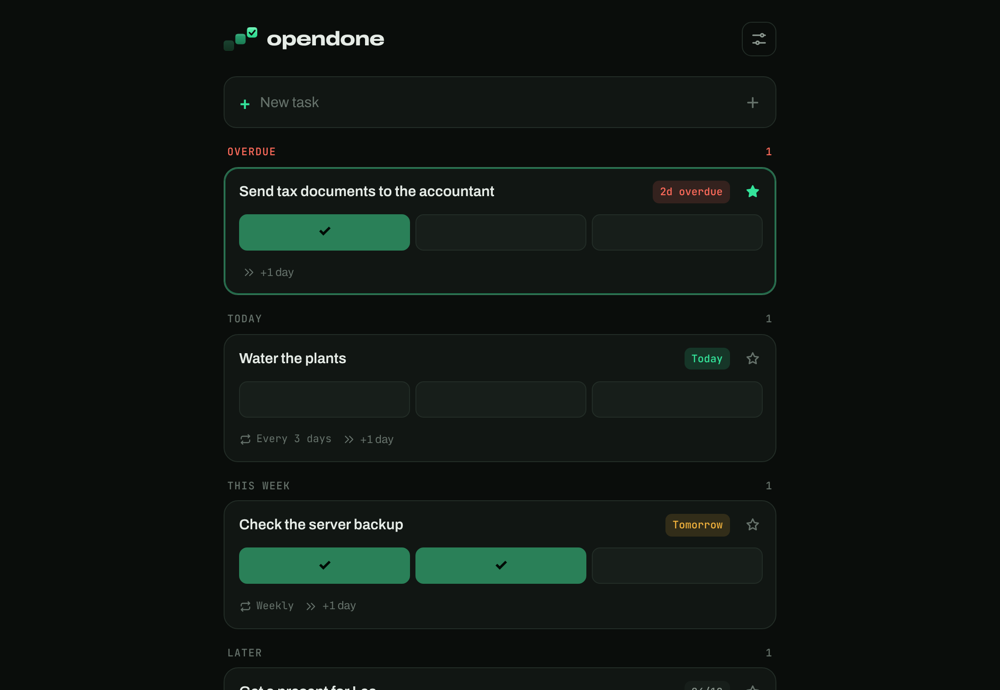

<p align="center">
  
</p>

<h1 align="center">OpenDone</h1>

<p align="center"><strong>Open source to-do list you can host yourself</strong><br>
Use it in the browser, or run it on your own server with one command</p>

<p align="center">
  <a href="https://professorengineergit.github.io/tasks/">Website</a> ·
  <a href="https://professorengineergit.github.io/tasks/app/">Try it</a> ·
  <a href="#self-hosting">Self-host</a> ·
  <a href="LICENSE">MIT License</a>
</p>

<p align="center"></p>

## What it is

Every task has three boxes: tap the first when you start, the second when you are halfway, the third when it is done. Tasks are grouped by when they are due (Overdue, Today, This week, Later, No date), repeat on their own, and sync live between your devices when you run the server.

It is meant for people who find Google Tasks fine but want it lighter, more flexible and under their own control.

- **Three-step progress** per task, as boxes or a bar
- **Groups by due date**, drag to reorder inside a group
- **Repeating tasks**: daily, weekdays, every 2 or 3 days, weekly, every 2 weeks, monthly, yearly
- **Notes**, important flag, "+1 day" button, quick dates ("Call mum tomorrow")
- **Live sync** between devices on your own server
- **Installable** as an app (PWA), works offline in browser mode
- **57 settings**: theme, accent color, fonts, density, sorting, and a drawer of extras (glow, confetti, CRT scanlines, matrix rain). Calm by default.
- **German and English**
- **Export and import** everything as JSON
- **Tiny**: the server has no dependencies and idles at about 20 MB of RAM

Not there yet: subtasks, several lists, push reminders.

## Three ways to run it

| | Where your tasks live | Sync between devices | Account |
|---|---|---|---|
| **Browser** (GitHub Pages or any static host) | This browser only | No | None |
| **Your server** (Docker or Node.js) | One SQLite file on your machine | Yes, live | Username + password |
| **Firebase** (optional) | Your Firebase project | Yes | GitHub login |

The app picks the right mode by itself: if it is served by the OpenDone server it uses the server, otherwise Firebase if configured in `web/config.js`, otherwise the browser.

## Self-hosting

### Docker

```bash
docker run -d --name opendone \
  -p 8080:8080 -v opendone:/data \
  --restart unless-stopped \
  ghcr.io/professorengineergit/opendone
```

Open `http://your-server:8080`. The first account you create becomes the admin. After that, sign-ups are closed unless you change `OPENDONE_SIGNUP`.

### Docker Compose

```bash
curl -O https://raw.githubusercontent.com/ProfessorEngineergit/tasks/main/compose.yaml
docker compose up -d
```

### Node.js, without Docker

Needs Node.js 22.5 or newer. There is nothing to install.

```bash
git clone https://github.com/ProfessorEngineergit/tasks opendone
cd opendone
node server/server.js
```

To keep it running, use the systemd unit below or any process manager.

### Settings

All settings are environment variables.

| Variable | Default | Meaning |
|---|---|---|
| `PORT` | `8080` | Port to listen on |
| `HOST` | `0.0.0.0` | Address to bind to |
| `DATA_DIR` | `./data` (`/data` in Docker) | Where `opendone.db` is stored |
| `OPENDONE_SIGNUP` | `first` | `first`: only the very first account can be created in the browser. `open`: anyone who can reach the server can sign up. `closed`: accounts are created on the command line only. |
| `OPENDONE_TRUST_PROXY` | `false` | Set to `true` behind a reverse proxy, so client IPs and HTTPS are detected from `X-Forwarded-*` headers |
| `OPENDONE_ORIGIN` | – | Public URL, e.g. `https://tasks.example.com`. Only needed if your proxy rewrites the `Host` header |
| `OPENDONE_SECURE_COOKIES` | `auto` | `true` forces the `Secure` cookie flag, `auto` sets it when the request came over HTTPS |

### Accounts

```bash
# Docker: prefix with "docker exec -it opendone"
node server/server.js user:add alice       # asks for a password
node server/server.js user:passwd alice    # set a new password, signs out all sessions
node server/server.js user:list
node server/server.js user:delete alice    # deletes the user and their tasks
```

If you expose a fresh server to the internet, create your account first (in the browser or with `user:add`) so nobody else can claim the admin account. With `OPENDONE_SIGNUP=closed` the browser sign-up is off completely.

### Behind a reverse proxy

Run OpenDone behind HTTPS when it is reachable from the internet. Set `OPENDONE_TRUST_PROXY=true`.

Caddy:

```
tasks.example.com {
  reverse_proxy localhost:8080
}
```

nginx (live sync uses server-sent events, so turn buffering off):

```nginx
location / {
  proxy_pass http://127.0.0.1:8080;
  proxy_set_header Host $host;
  proxy_set_header X-Forwarded-For $proxy_add_x_forwarded_for;
  proxy_set_header X-Forwarded-Proto $scheme;
  proxy_buffering off;
  proxy_read_timeout 1h;
}
```

### systemd

```ini
# /etc/systemd/system/opendone.service
[Unit]
Description=OpenDone
After=network.target

[Service]
User=opendone
WorkingDirectory=/opt/opendone
Environment=DATA_DIR=/var/lib/opendone
ExecStart=/usr/bin/node server/server.js
Restart=on-failure

[Install]
WantedBy=multi-user.target
```

### Backups and updates

Everything is in one SQLite database in `DATA_DIR`. To back it up while the server runs:

```bash
sqlite3 /path/to/data/opendone.db ".backup opendone-backup.db"
```

Every user can also export their tasks as JSON in **Settings → Data**.

To update: `docker pull ghcr.io/professorengineergit/opendone && docker compose up -d`, or `git pull` and restart for the Node setup.

## GitHub Pages and Firebase

The workflow in `.github/workflows/pages.yml` publishes the website at the root and the app under `/app/`. To turn it on: **Settings → Pages → Build and deployment → Source: GitHub Actions**.

Without further setup the Pages app stores tasks in the browser. To sync through Firebase instead, add a repository variable (**Settings → Secrets and variables → Actions → Variables**) named `OPENDONE_FIREBASE_CONFIG` with your Firebase web config as JSON:

```json
{"apiKey":"…","authDomain":"…","projectId":"…","storageBucket":"…","messagingSenderId":"…","appId":"…"}
```

In Firebase, enable GitHub as a sign-in provider and use these Firestore rules:

```
rules_version = '2';
service cloud.firestore {
  match /databases/{database}/documents {
    match /users/{userId}/{document=**} {
      allow read, write: if request.auth != null && request.auth.uid == userId;
    }
  }
}
```

### Coming from OpenDone 1.x ("tasks")

Version 2 reads the same Firestore data as 1.x, so setting `OPENDONE_FIREBASE_CONFIG` to the old config brings your tasks back on GitHub Pages. To move to your own server, open the Firebase version, go to **Settings → Data → Export**, then import that file on your server.

## Security

- Passwords are hashed with scrypt; sessions are random tokens stored only as SHA-256 hashes, in `HttpOnly`, `SameSite=Strict` cookies.
- Logins are rate-limited per IP and per username.
- Requests that change data must come from the same origin.
- A strict Content Security Policy is sent: no inline scripts, no third-party requests. Fonts, icons and confetti are bundled.
- Input is validated on the server: field types, lengths, date formats, at most 20,000 tasks per user.

Found a problem? Please open an issue.

## Development

```
web/        the app (plain HTML, CSS and ES modules, no build step)
  js/store/ storage backends: local, server, firebase
server/     the server (Node.js, node:sqlite, no dependencies)
site/       the website for GitHub Pages
brand/      icon sources; node brand/generate.mjs --png rebuilds all icons
```

Run the server and open `http://localhost:8080`:

```bash
node server/server.js
```

Or serve `web/` with any static file server to work on the browser mode.

## AI involvement

Parts of this project were written with AI tools: the 1.x version largely with GitHub Copilot (see the commit history), the 2.0 rewrite with Claude Code.

## License

[MIT](LICENSE). Bundled fonts are under the SIL Open Font License (see `web/fonts/LICENSE.md`); canvas-confetti is under the ISC license.
